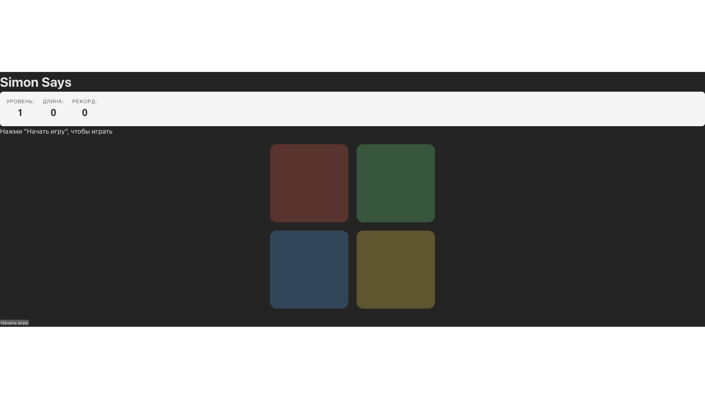
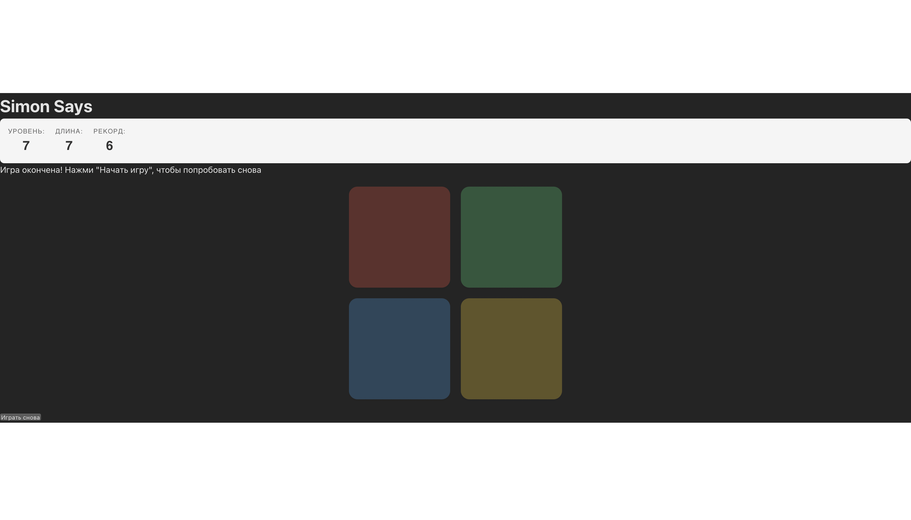

# Лабораторная работа №4 — Simon Says на React

Проект представляет собой UI-библиотеку компонентов и демонстрационное веб-приложение (игру на память «Simon Says»), разработанные на React и TypeScript.

## Структура проекта

Решение разделено на два независимых пакета:
1. **`ui-library`** — библиотека переиспользуемых UI-компонентов (`SignalPanel`, `ProgressIndicator`).
2. **`frontend`** — веб-приложение, которое использует компоненты из библиотеки для реализации игры.

## Реализованные компоненты

### 1. `SignalPanel`
Панель сигналов с четырьмя цветными кнопками (красная, зелёная, синяя, жёлтая). 
- **Пропсы:** 
  - `activeColor` — цвет, который должен подсветиться в данный момент.
  - `disabled` — блокирует нажатия (используется в режиме «только показ»).
  - `onColorClick` — колбэк, вызываемый при клике на кнопку.

### 2. `ProgressIndicator`
Индикатор прогресса игры.
- **Пропсы:** 
  - `level` — текущий уровень.
  - `sequenceLength` — длина текущей последовательности.
  - `record` — максимальный рекорд игрока.

## Запуск проекта

Так как проект разделен на две части, зависимости нужно устанавливать в каждой папке отдельно. Все команды выполняются из корня папки решения (`student-7`).

### Шаг 1: Сборка UI-библиотеки
```bash
cd ui-library
npm install
npm run build
```

### Шаг 2: Запуск фронтенда
```bash
cd ../frontend
npm install
npm run dev
```
Приложение откроется по адресу `http://localhost:5173`.

## Тестирование и линтинг

В обоих проектах настроены Jest и ESLint. Вы можете проверить каждый проект отдельно, перейдя в его папку (`ui-library` или `frontend`):

```bash
npm run lint
npm run test
npm run test:coverage
```

## Скриншоты работы

### Игровой процесс


### Окончание игры и рекорд


